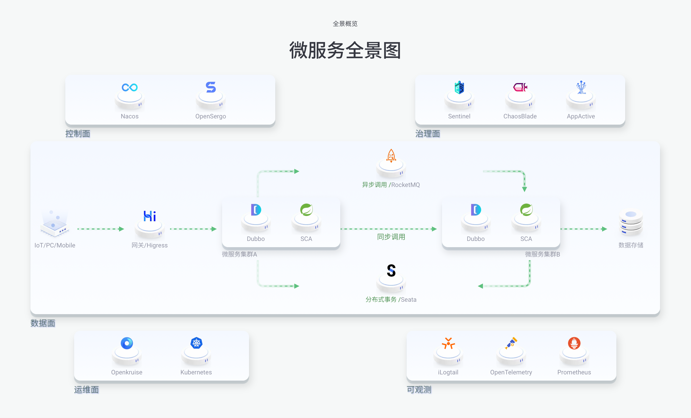

<!-- ═══════════════════ 🌌 时空曲率启动 · 未来已来 ═══════════════════ -->

  

<!-- ═══════════════════ ⌨️ 霓虹多色打字机 · 神经链接中 ═══════════════════ -->

  

 

<!-- ═══════════════════ 🧬 身份档案 · Identity Matrix ═══════════════════ -->

  &emsp;
  &emsp;
  &emsp;
  

   
  &emsp;
  &emsp;
  &emsp;
  &emsp;
  

 

<!-- ═══════════════════ 📊 数据核心 · 全息驾驶舱 ═══════════════════ -->
## 📊 数据核心 · Cyber Stats Terminal

<!-- ⌨️ 终端启动动画 · 链路已建立 -->

  

<!-- ⚡ 生命体征 · 实时动态徽章矩阵（shields 实时拉取 GitHub API） -->

  &emsp;
  &emsp;
  

 

<!-- 🔥 连击核心 · 品红金霓虹（streak-stats 实时数据） -->

  

<!-- 🌐 遥测网格 · 真实贡献能量场（ghchart 实时读取 GitHub 贡献数据） -->

  

<!--
  ⚠️ 备用组件：官方 github-readme-stats / activity-graph / trophy 公共实例
  已限流（503）或转收费（402），服务恢复后可取消注释启用：

  

  

  

  
-->

<!-- ═══════════════════ 🛸 全栈武器库 · Full-Stack Arsenal ═══════════════════ -->
## 🛸 全栈武器库 · Full-Stack Arsenal

### ☕ 后端核心引擎 · Backend Core Engine

  

### 🎨 前端神经界面 · Frontend Neural UI

  

### ☁️ 云原生舰队 · Cloud Native Fleet

  

### 👁️ 可观测性之眼 · All-Seeing Observability

  
  &emsp;
  
  
  
  

<!-- ═══════════════════ 🤖 AI Agent 军火库 · 智能体核心 ═══════════════════ -->
## 🤖 AI Agent 军火库 · AI Agent Arsenal

  

  &emsp;
  &emsp;
  &emsp;
  &emsp;
  

   
  &emsp;
  &emsp;
  &emsp;
  &emsp;
  &emsp;
  

<!-- ═══════════════════ 🚀 0→1 独立交付流水线 · Solo Pipeline ═══════════════════ -->
## 🚀 0→1 独立交付流水线 · Solo Delivery Pipeline

   ➜
   ➜
   ➜
   ➜
   ➜
   ➜
   ➜
   ➜
  

  <h4>💡 一个人，就是一支完整的特种部队 💡</h4>

<!-- ═══════════════════ 🏗️ 技术架构蓝图 · Future Blueprint ═══════════════════ -->
## 🏗️ 技术架构蓝图 · Architecture Blueprint

  

 

  <i>📡 Signal received from 2077 · The Future is Already Here · Powered by AI ⚡</i>

<!-- ═══════════════════ 🌊 时空曲率关闭 · 未来波动收尾 ═══════════════════ -->

  

